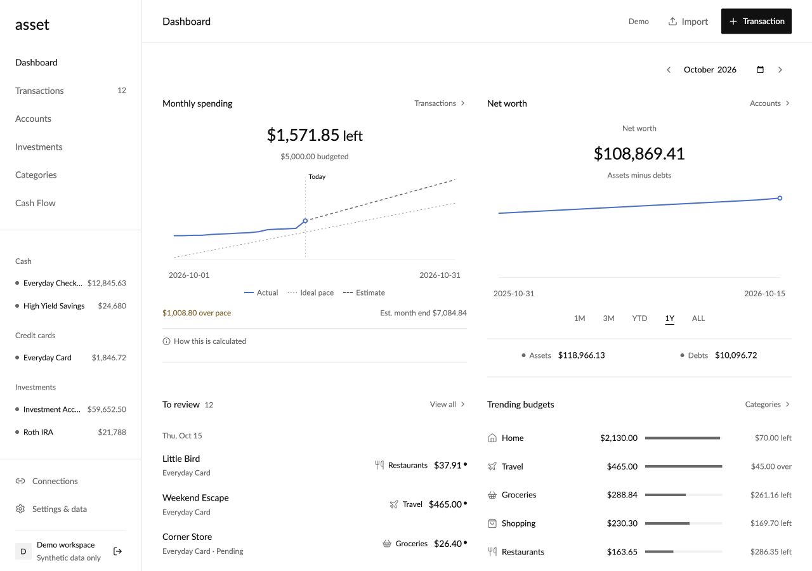
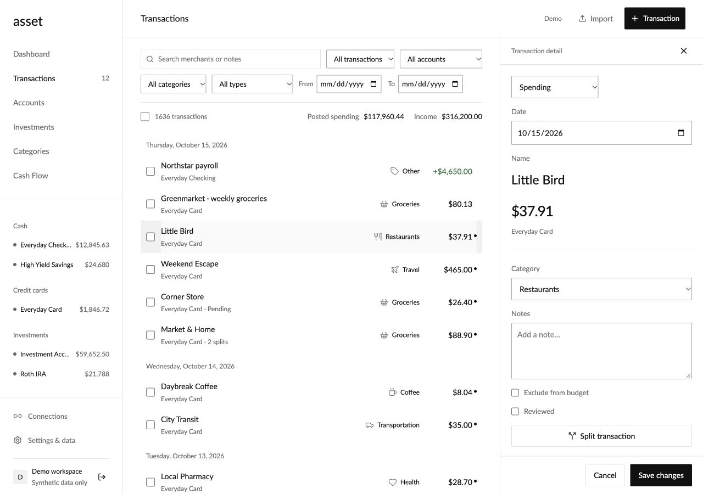
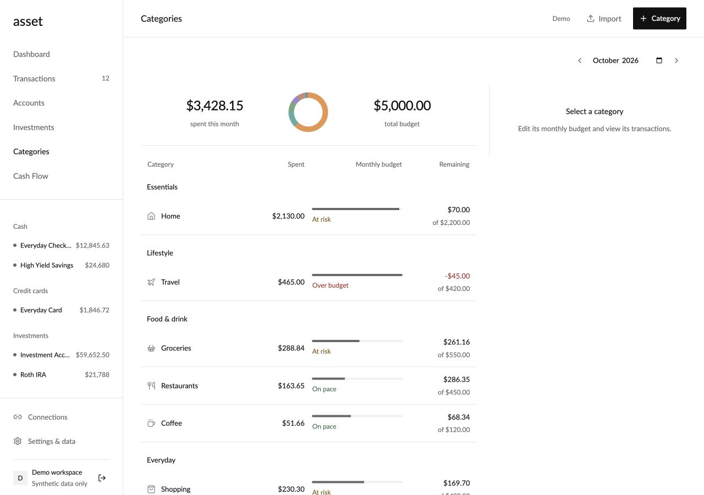
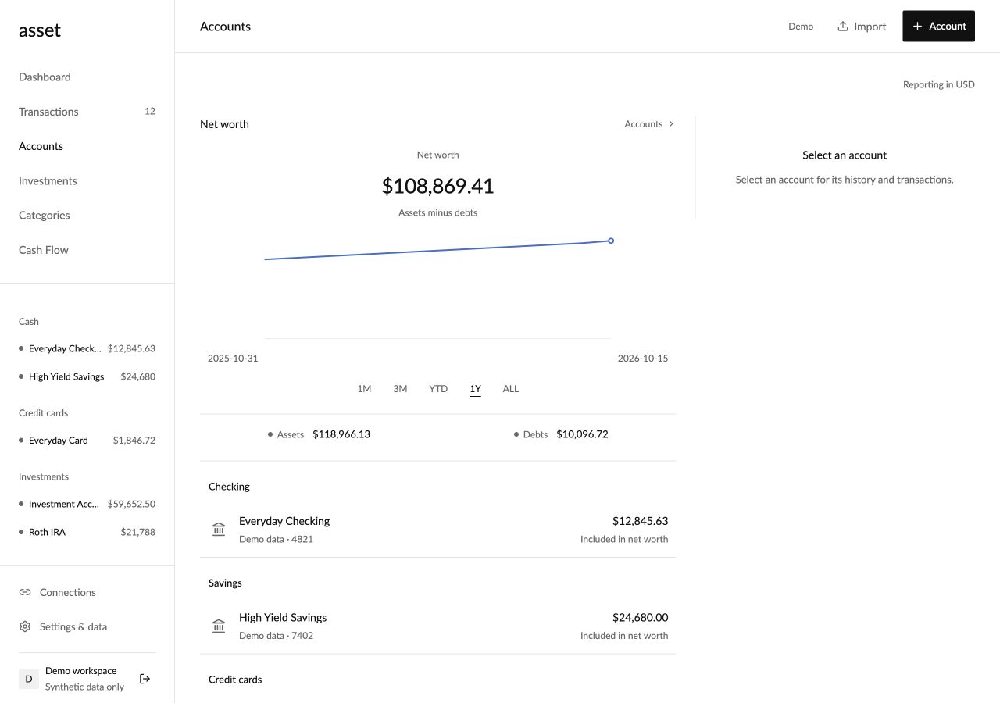
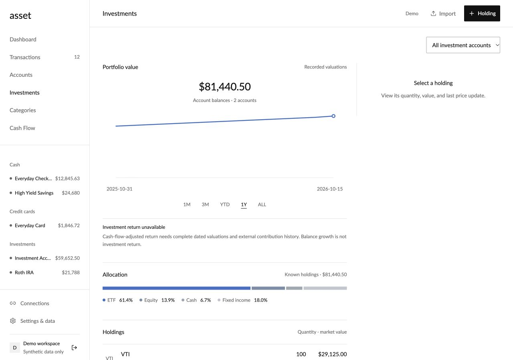
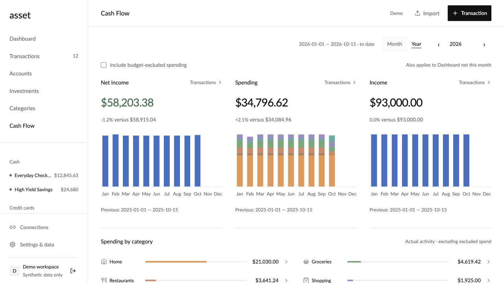

# Verification record

## October 28: compact account cards and loan payment history

Transaction sheets fit their content, with actions directly below the account card. Account rows show institution identity, balance, and credit utilization when a limit is available. Provider identifiers are replaced with institution names from the existing connection metadata; future bank refreshes persist the name for offline display. Unvalued manual history excluded from net worth appears under Other history, without deleting transactions or fabricating balances.

Loan accounts can link existing bank withdrawals without changing the original account, categories, exclusions, review status, statement balance, or financial totals. Suggestions require a lender plus an account reference or an unambiguous scheduled payment amount, and exclude inbound, pending, removed, or already-linked records. Links can be changed or cleared in transaction details. Account filters include linked payments; local workspace merge and subsequent bank updates preserve links. Bulk linking reads and syncs only the selected records.

The production web build, **226 web tests**, **142 native checks**, native resource freshness, and calculation parity pass. Tests include loan-link reversal, ambiguous matches, signed payment direction, preservation of totals and edits, workspace merge, and a bank refresh after linking. The 6,000-row database fixture transfers under 20 KB when linking one payment. Browser verification on synthetic data linked two payments, showed them under the loan while retaining their original checking account, and successfully removed one link. Build **12** includes these changes. The final signed archive passes and retains the approved FinanceKit entitlement. Web commits `f8ca4ce` and `6541470` deployed successfully; the final GitHub Web check passes. A single recorded account balance no longer renders an empty history chart, and bank-card gradients retain white-text contrast. Live loan links were verified after reload. TestFlight upload is not complete: the Mac is locked and Xcode cannot load its saved account token. Final simulator visual verification and upload confirmation remain pending the owner unlocking the Mac. The temporary simulator data was restored after testing.

## October 28: responsive Apple setup and background sync

Apple account setup no longer disables its entire list during an existing sync. Connecting an account queues its history independently of the setup form; linked accounts appear from the lightweight connection response, without waiting for the complete history download. The sync queue serializes accounts, prioritizes newly connected accounts, deduplicates requests, and advances past a stalled account after 60 seconds without progress. Stop cancels immediately, clears queued work, and retains acknowledged checkpoints. Every resumed provider callback checks a per-run cancellation fence before sending records or saving a checkpoint. Foreground requests are limited to once per five minutes, and changing workspaces clears queued work and account-specific messages.

Download merging, pending-edit replay, document encoding, request encoding/decoding, and FinanceKit row mapping now run away from the main UI executor. Document-generation checks reapply downloaded updates against concurrent local changes; older snapshots cannot replace a newer revision, and stale acknowledgements retain pending edits for retry. Existing delta sync and server conflict checks remain in place.

All **133 native regression checks** pass, including stalled-provider recovery, queued Apple Card after stalled Apple Cash, duplicate prevention, progress deadline renewal, immediate cancellation, late callbacks after retry, and a 6,000-row downloaded history merge that preserves an unsynced review and leaves the main actor available. These synthetic checks do not measure physical-iPhone sync speed. The iOS simulator build and signed **0.1.0 (10)** archive pass. A separate simulator-only fixture using the production setup view verified that consent and Choose Apple accounts stay enabled during a stalled sync, Stop restores idle controls immediately, and Done dismisses the sheet. No production financial records were changed. Actual Wallet authorization and Apple Card sync still require the owner's iPhone.

The responsive-setup build **10 uploaded successfully** at 1:48 AM Pacific. A follow-up build **11** adds Manage Wallet access and reloads shared accounts after returning from Settings. Apple documents that requestAuthorization does not prompt again after an access decision, so this gives missing accounts a recovery path without disconnecting an existing account. Build **11 uploaded successfully at 1:54 AM Pacific**. After the owner restored the App Store Connect session, **0.1.0 (11)** was confirmed **Testing** in the Internal group with one existing tester. The final fixture also verified that Manage Wallet access opens iPhone Settings; Wallet-specific permissions remain a physical-device check. The existing LinkKit missing-dSYM upload warning is non-blocking.

## October 27: review, loading, and Apple sync performance

Native commands now prepare changes and serialize the saved document on a dedicated actor, keeping the main UI thread available. Before committing, the Store verifies the workspace identity and document generation; a concurrent sync causes the command to be recalculated against the newer document. The final local save remains atomic. JavaScriptCore uses a JSON string boundary instead of bridging every nested Foundation property. Sync-path checks inspect only small metadata, saved documents no longer sort every key, and calculation results are cached until the state or workspace reporting date changes. Web startup no longer rewrites an unchanged saved workspace.

Bulk review uses indexed membership checks, and sync conflict checks index affected collections once. These changes preserve the existing whole-record conflict checks, review validation, categories, and user edits. Apple connection setup now selects only accounts and the target's investment records. Subsequent receipt matching limits amount candidates to the connected account and indexes them by amount. Initial iPhone sync reads balances first, displays account/progress messages, and connects only the chosen account rather than refreshing every Apple account again. Successful authenticator enrollment now dismisses its setup screen immediately after verification, before refreshing the workspace.

The web production build and **217 web tests** pass: 206 passed in the initial clean-copy run, and the 11 deployment tests passed after restoring the omitted API adapter to that copy. All **112 native Store/API checks** pass. A synthetic 6,000-transaction / 13.6 MB document benchmark fell from **3,864 ms to 1,269 ms** for preparing a bulk review through JavaScriptCore. This excludes disk writes and network latency. In the 25,000-row native harness, five cached Dashboard reads took **0.59 ms** after an initial **330 ms** calculation. These are optimized macOS computation results, not physical-iPhone end-to-end timings. Apple connection and sync tests verify bounded database results and preserved unrelated history, including other accounts with the same transaction amounts.

Commit `1f30ab3` passed GitHub Web checks and deployed to production (`asset-fsi2ewi6k-gtfol.vercel.app`). The live app loaded `index-Dk3vFELl.js` and displayed the corrected Venmo status. The final simulator build and signed **0.1.0 (10)** archive succeeded. TestFlight upload stopped before transmission because Xcode could not access its saved account credentials while the Mac was locked; build 10 is not yet confirmed uploaded. The same lock prevented a final native UI interaction check. Earlier build 9, containing only the Venmo label change, uploaded successfully.

## October 27: Venmo receipt balance labels

Venmo accounts without a balance now show **Receipts only** in account lists and the web sidebar. Account details explain that receipt forwarding tracks transactions without syncing the live Venmo balance. Missing balances no longer receive the web **Stale balance** badge. Other providers and known balances keep their existing display. No ingestion, balance calculation, or synchronization behavior changed.

The production web build and unsigned iPhone simulator build pass. Native build 9 carries the same display changes. Apple Wallet authorization and authenticator enrollment still require the account owner's iPhone.

## October 26: refined Layers logo

Applied the approved Layers design to the web favicon/header, native header, and iOS app icon. The three versions share tangent circular corners, a slim pale-blue lower stroke, and a diagonal blue gradient. The generated 1024px app icon is opaque with a square canvas for the system's corner mask; its colors explicitly use sRGB.

The production web build, simulator build, signed archive, and diff whitespace checks pass. The icon's dimensions and lack of alpha were checked, and the actual web and iPhone headers were visually inspected. The web build used the previously verified clean source copy with the updated SVG; the JavaScript and CSS bundle hashes remain unchanged. No financial logic or records changed. Build **0.1.0 (8)** preserves the FinanceKit entitlement in both the app and signing profile.

Commit `30e9087` passed GitHub Web checks (216 tests and production build) and deployed as `dpl_2DVb5VZ3uoF89umTV1EgkB5XqiwM`. The production `/icon.svg` response matches the approved source byte for byte. The installed simulator Home Screen icon was also visually checked. Build 8 uploaded successfully at **9:30 PM Pacific** on October 26; Apple reported that the package was processing. The existing missing LinkKit dSYM warning remains non-blocking. On October 27, build 8 was confirmed **Testing** in the Internal group with one tester.

Proof: [web header](screenshots/layers8-web-header.png), [iPhone header](screenshots/layers8-ios-header.png).

## October 25: daily review cards and visual refresh

Dashboard review now groups the newest unreviewed date into cards with at most six visible transactions. Each card has one **Mark as reviewed** action and Undo; reviewing advances to the next batch or day. Tapping a row opens a compact detail sheet with category search, notes, separate Save and review actions, and access to the existing advanced editor. Category corrections can save an account-scoped merchant rule. Existing matching rules are updated instead of duplicated. The main review flow does not use selection checkboxes.

Web and native share a blue/navy palette, rounded surfaces and controls, colored line-icon category pills, and an original Asset mark. Web review follows Spending; the native Spending card is shorter so review is nearer the top. Merchant suggestions fill uncategorized spending using recognizable names and saved rules, without external AI requests or a history-wide reclassification. FinanceKit imports now apply these same rules. Manually edited categories and splits remain protected; a new Apple regression verifies that a later Wallet refresh preserves a category correction.

All **216 web tests** pass in a serial run with a 60-second per-test limit. The initial concurrent run had three default five-second timeouts during slow local dependency reads, without assertion failures; the complete serial rerun passed. TypeScript, native resource freshness, calculation parity, **112 native Store/API checks**, the simulator build, and the signed archive pass. The production web build, including the offline worker generation, passes from an identical source copy with a clean dependency installation after dependency reads in the working checkout stalled. The bundle-size advisory is non-blocking.

Synthetic browser checks verified daily review **242 → 236**, Undo **236 → 242**, category/note Save retaining 242, and individual review **242 → 241**. Reopening showed the saved category and note; the advanced editor retained both, and Settings showed the scoped merchant rule. Desktop 1365px and mobile 390px layouts were inspected, including mobile dark mode. Native checks verified individual review **236 → 235**, daily review **235 → 234**, Undo **234 → 235**, category editing, and the final compact dashboard/detail layout. The computer-control service could not operate native coordinate/scroll gestures; physical-device sheet dragging and scrolling remain unverified. No real financial records were changed during these checks.

Signed iOS **0.1.0 (7)** archived and uploaded successfully at **9:35 PM Pacific**. The app and provisioning profile both contain `com.apple.developer.financekit: ["financial-data"]`. Apple reported the package processing; the existing missing LinkKit dSYM warning is non-blocking. After the owner restored the App Store Connect session, build 7 was confirmed as **Testing** in the Internal group with one tester. Concise testing notes were saved. Real Apple Wallet consent and sync remain unverified and require a physical iPhone.

Commit `87a951b` passed GitHub Web checks and deployed to production as `dpl_F4qCCefshNtcow2cAbqchyLAj8wN` at 9:46 PM Pacific. The signed-in live browser loaded the matching `index-B-g0GS6w.js` bundle, showed the new mark and daily **Mark as reviewed** card, and reported Synced. The live review card contains no selection checkboxes. No production transaction was edited or marked reviewed during this verification.

Proof uses synthetic data: [web review dashboard](screenshots/review7-web-mobile-dashboard.png), [web detail sheet](screenshots/review7-web-detail.png), [web dark sheet](screenshots/review7-web-dark.png), [iPhone detail sheet](screenshots/review7-ios-detail.png).

## October 25: dashboard review and Apple activation

Web and native dashboard review now supports dated rows, six visible transactions, individual editing, selected/shown batch review, and Undo. Copilot was inspected only in its user-enabled demo mode; no real financial transactions were reviewed or changed. Browser checks with synthetic local history verified selection count 236 → 234, Undo → 236, category/note edits preserved by Save & review, Save only retaining the queue count, and View all opening the unreviewed filter. Desktop 1365px and mobile 390px layouts were inspected; mobile category/amount collisions were corrected. Native simulator checks verified selected batch review 236 → 234 and Undo → 236, and opened the individual review form. The computer-control service could not operate native coordinate/scroll gestures, so final native scrolling and the toolbar Review action remain unverified.

All **210 web tests**, the production build, native resource freshness, **112 native checks**, calculation parity, and the unsigned simulator build pass. New Apple regressions cover scoped database result payloads under 15 KB against 4,000 unrelated transactions, preserved import edits, same-batch retry, fallback/corrected historical balances, conflicting balance IDs, and expired-checkpoint replay preserving user edits. This measures synthetic database results, not monthly billed egress.

Apple updates now use scoped database reads, atomic record patches and revision-only responses. Cursor identity survives session refresh. Expired-history rebuilds preserve transaction edits and import provenance. The + menu includes Connect Apple accounts; web Connections explains the iPhone setup path.

Commit `4a12e9c` passed GitHub Web checks and deployed to `asset.gtfol.dev` on October 25 at 1:28 AM Pacific. The live browser loaded the matching bundle, displayed the six-item review action, and reported Synced with no visible errors. Production financial records were not changed during verification.

With the user's action-time approval, FinanceKit was enabled for **org.gtfol.asset** on **J59ZSG67SJ** and both development and App Store provisioning profiles were regenerated. The refreshed profile requires `com.apple.developer.financekit` to contain `["financial-data"]`; the app entitlement was corrected to match. Signed archive validation confirmed that value in the app and profile, build **0.1.0 (6)**, and `AssetFinanceKitEnabled: true`. The archive and App Store export/upload succeeded at 1:38 AM Pacific. Processing completed, and the Internal group shows build 6 as **Testing** with one existing tester. Testing notes are saved. Upload reported the existing non-blocking missing LinkKit dSYM warning.

Production `FINANCEKIT_ENABLED` was enabled and deployment `dpl_E96jeWqRDDQRp6NXyzsrZG9VMrNm` reached Ready with the `asset.gtfol.dev` alias. A signed-in browser read of `/api/apple` returned `available: true`. No Apple accounts were connected and authenticator enrollment was not performed. Real Wallet consent and sync require a physical iPhone and remain unverified; synchronization runs on foreground unlock or manual refresh, without a background extension.

## October 24: record-level bank and edit sync

Migration 014 adds an owner-isolated, RLS-protected change journal. Changed records, removals, and small settings values are recorded atomically with the workspace revision. Web and iOS build 5 request deltas and persist a confirmed base for offline replay; old clients, first sign-in, journal gaps, and oversized changes retain a complete-snapshot fallback. The journal is bounded to 256 commits and 256 KiB per commit. No existing financial records are deleted or migrated out of the canonical workspace.

Ordinary commands select only their affected transaction/snapshot records plus account/category/rule/settings context. PostgreSQL merges the delta into the canonical JSON document without returning unrelated history; record limits and exact-arithmetic totals are checked inside the database. Plaid updates select changed provider IDs, reconciliation candidates and recurring context. Coverage still aggregates unloaded history inside PostgreSQL. Existing same-day snapshot IDs and unchanged account timestamps stay stable, avoiding idle revisions. Investment activity/holdings already supplied by Plaid are compared in the database and identical records return compact IDs. Lease validation no longer retrieves the staged provider pages. Venmo ingestion reads matching candidates and daily spending alerts select only today's effective transaction dates.

All **208 web tests**, TypeScript/Vite build, native resource freshness, **112 native checks**, and Node/JavaScriptCore parity pass. Regressions include an 8,572,805-byte, 6,000-transaction workspace; one edit used **4,085 bytes** of database result payloads (including its delta read), with a **1,584-byte** client delta. A second unchanged bank refresh used **2,156 bytes** of database result payloads and retained its revision. Updating one of 1,000 investment activities used **37,882 bytes**, including the compact unchanged-ID list and client delta, while preserving all activities and unrelated transactions. Tests also cover imported user categories/notes/exclusions, pending replacements and removals, earliest coverage across unloaded history, aggregate overflow rollback, missing journal versions, owner changes, offline create replay, conflicting edits, and lost-response retries. These are synthetic result-payload measurements, not Supabase-billed bytes or a measured monthly total.

Commit `d1eae8a` passed GitHub's web checks and deployed successfully to production. A real Bank of America refresh completed healthy at 2:01 PM Pacific, retained revision 170 because the records were unchanged, and returned a 2,458-byte conditional response without a state document. The refreshed browser reported Synced. The existing complete workspace response measured 7,018,342 bytes; this live comparison verifies the no-change bank path, while the synthetic regressions above verify changed records and edits.

Signed iOS **0.1.0 (5)** archived and uploaded successfully on October 24 at 2:01 PM Pacific. Apple reported the uploaded package processing. Upload reported the existing non-blocking missing LinkKit dSYM warning. TestFlight tester availability has not been verified; install build 5 when available to receive record-level native sync.

Normal-use egress should now be substantially below the earlier 6–8 GB projection, but actual billing includes protocol overhead, all background services, bootstrap downloads, imports and older clients. Continuous Bitcoin price/wallet refresh routes still use full-state responses and are outside these bank/edit measurements. Do not promise a hard monthly quota from synthetic per-operation measurements.

## October 24: conditional workspace sync

Web and iOS now include the cached owner and revision in workspace checks. PostgreSQL returns a null state for matching versions, and the API returns an `unchanged` response with fresh session/connection metadata. The ledger is neither transferred from Supabase nor rewritten on-device during idle checks. First sign-in, another owner's workspace, and changed revisions still receive a complete snapshot. Older clients remain compatible. No-op mutations retain their revision while still recording operation acknowledgments.

Daily notification scheduling selects settings and notifications instead of full workspaces; it loads the ledger only when a summary is due. Push delivery selects the individual notification and preferences. No schema migration or data deletion is required.

All 200 web tests, the production build, native resource freshness, 109 native checks, and Node/JavaScriptCore parity pass locally. Regressions cover database response size (under 100 bytes for an unchanged synthetic ledger), repeated checks without device writes, cached restart, changed revisions, same-version account switches, fresh connection metadata, authentication, offline operations, conflict/lost-response retries, and notification scheduling before/after the daily summary. Native build 4 contains the client change; build 3 still requests complete snapshots.

Commit `3fa0656` deployed successfully to production and passed GitHub's 200 web tests and build. The authenticated production workspace response measured 7,018,342 bytes before the conditional request and 2,458 bytes with the same owner/revision (170), containing five connection summaries and no state document. The deployed browser loaded the new bundle and reported Synced after reload and manual sync. These measurements describe response payloads, not a measured reduction of total monthly egress; previously consumed bandwidth remains in the billing cycle.

Signed iOS **0.1.0 (4)** archived and uploaded successfully on October 24 at 1:26 PM Pacific. Apple reported the uploaded package processing. The first archive failed because the Documents build folder acquired Finder metadata; a clean build under `/tmp` succeeded. Upload again reported the existing missing LinkKit dSYM warning. TestFlight tester availability could not be verified because the App Store Connect browser session is signed out; build 4 must be installed for conditional native sync.

## October 24: private cloud access

`ASSET_ALLOWED_EMAILS` restricts new Google workspaces, new web/iOS sessions, existing cookie/bearer sessions, Plaid jobs and webhooks, Venmo receipt processing, and notification work to explicitly allowed Google identities. Production demo creation is disabled. Blocked browser sessions lose cloud controls while retaining their local records and pending edits. Existing hosted records are not deleted.

All 193 web tests and the production build passed in GitHub Actions. Local TypeScript checking and the production build also passed; the initial local bundler stalled while transforming dependencies and was stopped before a successful retry. Tests cover allowed browser login, rejected Google identities, native callback/code rejection, existing cookie/bearer sessions, exact email matching, empty/invalid configuration, blocked demo creation, paused background work, and preservation of local records.

Commit `c77aab9` deployed successfully. Production and Preview have a single allowed email. The deployed demo endpoint returned 410, unauthenticated workspace access returned 401, and the existing owner's browser session reopened and reported Synced. Vercel's existing protection covers deployment URLs other than custom domains. This server change applies to existing iOS builds without a new TestFlight upload. Restricting cloud access does not eliminate repeated full-workspace reads for the allowed owner; reducing those transfers remains separate work.

## October 18: native layout and add menu

The native + button now opens the same five actions on every tab: transaction, account, Bitcoin wallet, holding, and category. Adding a transaction before an account exists offers account creation first. Bitcoin setup is available through + instead of a standalone Accounts section. Dashboard no longer repeats its title or introductory copy. Transactions uses regular Lato at 15pt, 13pt supporting text, a compact search field, and quiet empty states. Empty Accounts no longer shows a zero-balance chart and two oversized empty-state panels. Dynamic Type scaling remains enabled.

The simulator build and signed **0.1.0 (3)** archive pass. Dashboard, Transactions, Accounts, all five menu destinations, the transaction account prerequisite, and the Bitcoin sign-in prerequisite were visually inspected. A fresh-launch check caught a first-selection routing issue; the sheet now uses the selected action as its identity, and choosing category first opens the category editor. The shared editor's Cancel control is explicitly leading and was verified to dismiss without saving. Search entry, clearing, keyboard dismissal, dark appearance, and text two sizes above the default passed; original display settings were restored. No financial records were changed. Real-device sign-in and populated-ledger behavior were not re-tested for this UI-only change.

Build **0.1.0 (3)** uploaded successfully on October 18 at 11:41 AM Pacific using the existing Xcode account. Apple accepted the package for processing. The upload reported the same non-blocking missing LinkKit dSYM warning as build 2. TestFlight availability and build 3 testing notes remain unverified because the App Store Connect browser session expired; upload success does not yet establish tester availability.

## October 18: local workspaces and legal pages

Both apps open into an empty workspace without a demo or sign-in gate. Web edits persist in IndexedDB; iOS uses an atomic, protected workspace file. Optional Google sync adds local records to the existing account and queues later edits with owner checks, conflict detection, and idempotent retries. Browser tabs serialize local writes. Import timestamps and holding snapshot dates remain stable through delayed retries. Old native synced caches require one successful connection before editing after migration.

185 web tests pass with two workers, including storage failures, concurrent tabs, offline edits, owner isolation, merge, conflict, and lost-response retries. The initial unrestricted parallel run timed out under simultaneous Xcode compilation; the bounded run passed all tests. TypeScript/Vite build, bundled native-resource check, 103 native checks, and Node/JavaScriptCore calculation parity pass. A production preview was stopped and the app still reopened with its locally saved synthetic account. Existing production records loaded after deployment. iPhone simulator startup and optional Settings sign-in were visually inspected; the real-device Google callback still needs a retry on the updated build.

Asset's `/privacy` and `/terms` are published, with permanent redirects from the `.html` paths. The FinanceKit agreement and request were submitted to Apple as request **739VT6P73Z**; the entitlement is still pending and Apple account sync remains disabled. Signed iOS build **0.1.0 (2)** uploaded successfully on October 18. The retry used the existing Xcode login without changing credentials. App Store Connect shows build 2 as **Testing** in the Internal group with one tester, and its testing notes are saved. The upload reported a non-blocking missing LinkKit dSYM warning; crash symbolication inside that third-party framework may be limited.

The sections below record earlier verification runs and their limits at the time.

October 15–17, 2026. Web and native automated checks and builds were re-run October 16 after moving to the Capsule-style repository layout. Final native transaction interaction checks completed October 16 before the folder move. The web app and API are published at asset.gtfol.dev, with demo creation, Supabase persistence, and sign-out verified on the deployed app. The native app remains a local simulator build. All financial values in the screenshots and automated tests are synthetic. No private banks, paid services, or Plaid Production connections were accessed.

## Build and automated results

| Check | Result |
| --- | --- |
| `npm test` in `apps/web` | **124/124 passing**, eleven suites including Bitcoin history and authenticated address tracking. Calculation, CSV/backup, persisted state, owner isolation, native bearer-session revocation, Plaid fixtures, Link diagnostics and environment separation, transaction browsing, and verified Supabase TLS regressions. |
| `npm run build` in `apps/web` | **Pass.** TypeScript check and Vite production bundle. Web JavaScript approximately 455 KB / 137 KB gzip. A separate fresh install/build containing only the web directory also passed. |
| `npm run native:check` in `apps/web` | **Pass.** The checked-in native engine, fonts, and license notices match their web sources. This check is separate from the web build. |
| `node scripts/native-parity.mjs` in `apps/ios` | **Pass.** Node and JavaScriptCore agree on Dashboard, Cash Flow, net worth, holdings, edit propagation, CSV preview, full backup restoration, and exact Bitcoin valuation. No web dependencies are needed by this native runner. |
| `node scripts/native-store-tests.mjs` in `apps/ios` | **Pass, 92 checks.** Compiles production Store.swift with the checked-in shared engine in a temporary bundle. Covers identities, deterministic order, filters, date groups, paging, state replacement, nested mutations, cache invalidation, Google PKCE vectors, and native callback validation without reading or writing an app workspace. |
| Xcode simulator build | **Pass.** SwiftUI/Charts, iOS 18 minimum target, official LinkKit 7.2.2; built using Xcode 26.6 / iOS 26.5 SDK without distribution signing. The project at `apps/ios/Asset.xcodeproj` builds with self-contained fonts and resources. The preceding transaction-performance build was installed on iPhone 17 Pro and iPad mini; loading/filter/selection/review checks and final date-header inspection passed October 16. |
| `npm audit` | **0 vulnerabilities** in the checked lockfile on October 15. |
| Container build | **Not verified.** Docker is installed but its daemon was unavailable. |
| Plaid Sandbox | **Code and provider fixtures verified; live execution unverified.** Credentials have not been configured. |
| Plaid native OAuth / physical device | **Unverified.** Requires approved server/domain, associated domains, team signing, and Plaid configuration. |

The calculation suite covers integer cents, invalid dates/references, split conservation and category-part totals, refunds, transfers, pending records, excluded spending, currency separation, scoped review, merchant rules, monthly budget isolation, archived categories, timezones/DST, leap days, projection edge cases, missing coverage, partial-period comparisons, annual reconciliation, debt signs, stale/missing holdings, CSV duplicates, and full-state restoration. Import regressions verify that manual name/date edits and merchant-rule renames do not create duplicate imports, and that unrelated rows matching an edited display name remain distinct.

Provider tests cover authenticated token encryption, ES256/body/timestamp verification, pagination mutation restart, partial-failure cursor rollback, repeat/out-of-order webhook jobs, 730-day initialization, pending-to-posted replacement, modified/removed records, manual correction preservation, exact manual overlap, split conflicts, duplicate Items, product selection, reauthentication, changed account selection, separate investment pagination, missing quotes, snapshots, update events, disconnect, persistence reopening, stale writes, and cross-owner denial. These use fixtures, not a live institution.

## Bitcoin history and sign-in spacing · October 17

Bitcoin tracking is available in signed-in web and iOS workspaces. The new regression suite verifies mainnet address checksums (including SegWit/Taproot), exact satoshi valuation, pending exclusion, historical quantity changes, a six-year-old receipt, missing daily prices, incomplete/changed provider history, bounded pagination, shared price caching, authentication, owner isolation, duplicate addresses, protected tracked values, backup preservation and stopping tracking. The public Coinbase endpoint returned 4,107 daily closes from July 20, 2015 through October 16, 2026 in about 2.7 seconds; no user wallet was queried in that verification.

The production web UI was exercised against a separate in-memory local server with synthetic wallet/provider data. Creating an address produced the correct current balance and a 4,108-day account history; selecting ALL exposed the 2015–2026 range with changes in held quantity in 2020 and 2022. Desktop and 390 px account details were visually inspected. Sign-in's inherited fixed brand height was removed and the heading-to-description spacing was inspected at both widths. Screenshots: [full Bitcoin history](screenshots/web-bitcoin-history.jpg), [phone Bitcoin detail](screenshots/web-bitcoin-mobile.jpg), [phone sign-in](screenshots/web-signin-spacing.jpg).

All web tests, production build, native bundle freshness, calculation parity, 92 native checks and the unsigned iPhone/iPad simulator build passed. A fresh isolated simulator was prepared with synthetic data, but its visual check is pending because the Mac was locked. No TestFlight upload or real-user wallet connection is claimed. See [Bitcoin tracking](BITCOIN.md) for provider, activity and history limits and [account connections](ACCOUNT-CONNECTIONS.md) for the next Venmo/Apple milestone.

The release commit `022cc6b` is deployed on `https://asset.gtfol.dev`. Vercel reported success, both GitHub Actions workflows passed, the live client served the new Bitcoin flow and spacing stylesheet, and an unauthenticated wallet-creation request returned 401 after API initialization. The signed-in live Accounts screen and empty Bitcoin address form were inspected without submitting a real wallet address. Plaid Trial was separately activated with the user's explicit approval; its dashboard showed 0/10 connections.

## Link error diagnostics

October 16: a reported Bank of America attempt displayed only Plaid's generic error screen. The screenshot did not establish an underlying error code or institution-registration status. The web client now retains only validated error code, request ID, and Link session ID from the current attempt's ERROR event or exit callback, including an ERROR followed by a null exit error. These fields remain in memory and appear in a collapsed Details section; no SDK payload, credential, token, account metadata, or raw developer error message is logged or persisted. Known customization and institution-access codes receive actionable setup messages without prescribing a paid upgrade. New attempts, completion, closure, and stale callbacks cannot carry prior diagnostics forward; ordinary cancellation stays quiet.

All 113 web tests and the production build pass. A local synthetic Link stub verified the actual Connections dialog's ERROR/null-exit fallback, readable Details at desktop and 390×844 widths, and clearing on retry. The stub called no bank or Plaid API. The user's Bank of America failure remains undiagnosed until its actual error code or Plaid Dashboard event is available.

## Production enablement

On October 16, the owner explicitly approved enabling real-bank access with each user's own Plaid credentials. The hosted default is Production, and the normal credential form has no environment picker. The server requires explicit per-user credentials and routes only to Plaid's two official API hosts; it has no shared environment-key fallback. Sandbox is limited to local development, an explicit developer server flag, or already-saved Sandbox configuration. Saved Sandbox data remains visibly labeled, and changing the form draft cannot change the environment used by an existing Link action.

Connection identities now include the environment. Migration 006 marks existing connections as Sandbox (the only environment prior builds allowed), and a Production connection receives a separate identity rather than taking over a disconnected test connection. Active connections still block credential-account/environment changes. This enablement does not verify a user's Plaid permissions or a real bank connection: each user supplies their own approved Production credentials and completes official Link. No real bank was connected during implementation.

All 106 web tests, TypeScript/Vite build, native resource check, 92 native checks, calculation parity, and unsigned simulator build passed. Regressions verify both official API hosts, hosted Sandbox restrictions, legacy secret rotation, credential/environment change guards, and preserved Sandbox accounts and transactions after Production sync even when provider IDs overlap. Environment mismatches fail before Item requests. The emitted Vercel Node 24 function includes migrations 001–006 and passes initialization, demo/session/state, trusted-CA, and initialization-retry checks.

Commit `324aeb7` deployed successfully to `asset.gtfol.dev`. Hosted configuration reports Production as its only supported environment for a new workspace, with encrypted storage and the worker ready. Authenticated state loads after migration 006; the synthetic demo still contains 6 accounts and 1,635 transactions, and the temporary verification session was revoked. The live private-workspace form was visually checked at desktop and 390×844 phone widths: Client ID and Production secret, no environment picker, correct OAuth redirect, and no recorded browser warnings/errors. No credential or bank connection was submitted during these checks.

## Per-user Plaid and resumable synchronization

Initial October 16 implementation, before the Production enablement above: web and iOS Connections accepted each signed-in user's own Plaid Client ID and Sandbox secret. Credentials are validated before storage, encrypted with the server key, and owner-bound. Only the masked Client ID is returned. Tests verify owner separation, ciphertext owner binding, backup/state exclusion, same-account secret rotation, rejection of unsafe replacement/removal while connected, and version checks against in-flight exchanges. Manual workspaces still load if provider credentials become unreadable. A browser session identifier prevents a connection callback or credential form from crossing into a login changed in another tab.

The worker uses durable per-connection jobs, generations, leases, and staged pages. Tests exercise interrupted pagination, cursor mutation restarts, atomic rollback, stale lease fencing, same-body notifications arriving later, changed account selection, per-owner provider resolution, and paginated investments. Additional regressions cover concurrent reconnects, delayed disconnects and update-mode callbacks, separate web/native redirect URLs, worker-independent revocation, request deadlines, bounded cleanup, and no automatic retry of one-use token exchanges. The API returns after queuing work; authenticated Vercel Cron resumes it within a 45-second work budget.

The browser retains only an expiring, session-bound Link context for OAuth recovery. Tests cover malformed redirects, expiration, session mismatch, and API headers. The Connections dialog suspends its native modal while Plaid opens, preserving the Link handler without making the provider overlay inert. Actual Plaid overlay interaction and OAuth returns remain unverified without user-supplied Sandbox credentials.

All 98 web tests, the TypeScript/Vite build, native-resource check, 92 native regressions, calculation parity, and unsigned simulator build pass. The emitted Vercel Node 24 function includes migrations 004 and 005, initializes them, and passes demo/session/state checks. Real Sandbox linking, webhook delivery from Plaid, signed-device OAuth, and Production access remain unverified. The native credential form builds but has not received a new rendered-device review in this change.

The live Vercel deployment applied the credential migration and reports encrypted storage and worker configuration ready. The browser retained its Google session through the deployment and displayed the per-user form with the correct web redirect URI. The OAuth return path serves the app, unauthorized worker requests return 401, and the synthetic demo still returns 6 accounts and 1,635 transactions. No Plaid credentials or private financial records were submitted during these hosted checks. The final form was visually inspected at desktop and 390×844 phone widths, with full-width mobile credential fields and no recorded browser warnings or errors. Vercel's registered minute-level cron completed against the deployed endpoint at 16:42:46 UTC on October 16, logging `processed: 0` for the empty queue. Both GitHub web and iPhone checks passed; this confirms worker invocation, not a live Plaid synchronization.

## Google authentication and Vercel API

October 16: email/password forms and server sign-in routes were removed. Google OAuth uses the direct `https://asset.gtfol.dev/api/auth/callback/google` callback. Google ID tokens are verified with Google's signing keys, issuer, audience, expiration, authorized party, verified email, and flow nonce. Browser state cookies and server-side PKCE protect callback completion; iOS exchanges a one-time code using an independent PKCE verifier. Workspaces map by Google subject and never merge solely by email. The native browser flow handles cancellation and workspace changes; Keychain replacement preserves the old credential when a replacement fails.

The current `@vercel/node` builder was run independently against the app. Its emitted Node 24 function booted and passed demo creation, session-cookie creation, authenticated populated state, and missing-database recovery checks. All migration files and the official Supabase root CA were included. Runtime ESM imports and explicit TypeScript type roots were checked in the emitted artifact. Supabase connections retain certificate-chain and hostname verification; a direct TLS 1.3 handshake to the configured pooler passed with the bundled CA.

The deployed API at `https://asset.gtfol.dev` then passed database initialization and automatic migrations, demo creation with a Secure/HttpOnly/SameSite cookie, reading 6 synthetic accounts and 1,635 transactions, saving an account name, reloading the persisted change, and restoring the original name. Email login returned 410, an untrusted write origin returned 403, and sign-out revoked the session (the next state request returned 401). The browser's Explore the demo button loaded Dashboard and remained signed in after refresh, with no recorded browser errors or warnings. [Hosted demo screenshot](screenshots/web-hosted-demo.jpg).

After the Google credentials were added to Vercel and redeployed on October 16, the live configuration reported Google sign-in enabled. The browser completed Google's account selection, returned through Asset's direct callback, and opened a private workspace. The session survived a page refresh; signing out returned to the welcome screen, and a second Google sign-in succeeded. No financial records were added during this check. The native Google browser/callback round trip remains unverified.

Vercel requests and responses have a 4 MB application guard below the platform limit. Oversized state is rejected before commit. The persistent Node deployment retains its existing larger limit. The resumable Plaid worker now runs through authenticated Vercel Cron when its server configuration is enabled.

## Code review corrections

The review covered web and native interfaces, shared calculations/schema/imports, server authentication/storage/provider handling, tests, scripts, configuration, and documentation. Web styling now has one canonical stylesheet instead of a base theme plus competing overrides. Navigation selection is monochrome, category icons use semantic line symbols on both platforms, and older stored emoji values remain readable through the icon resolver without rewriting financial records.

CSV deduplication now uses original import identity through edits, merchant rules, backup restoration, and provider attachment. Native requests use bearer authentication without relying on a cookie jar; signing out revokes the captured session and clears the local cache. Workspace-generation and revision checks prevent delayed responses from replacing a newer or switched workspace. Login loads and validates the new state before displaying it. Store.swift passed independent Swift typechecking; the API regression verifies cookie-free logout revokes the requested session while leaving another valid session intact. The delayed-response safeguards were reviewed in source, not independently exercised in an automated native networking harness.

## Feature checklist

| Area | Implemented behavior | Verification |
| --- | --- | --- |
| Dashboard | Actual spend, budget left, ideal pace, separate disclosed estimate, review queue, category progress, net-this-month link | Browser desktop/phone and native rendered; shared engine tested. |
| Transactions | Date groups, all requested filters, detail editing, notes, exclusions, selected review, manual entries, splits, rules, provenance | Web name/note/review changes persisted across refresh; native name/review edit persisted across app reinstall/relaunch without deleting data. Split/provider-conflict handling covered by tests. |
| Categories | Groups, semantic line icons, monthly budget edit, archive, remaining/over-budget text, transaction drill-down | Rendered on desktop, phone web, and native. Budget isolation and recalculation tested. |
| Accounts | Assets/debt/net worth, recorded history/ranges, grouped balances, account detail, inclusion and coverage | Rendered on desktop, phone web, and native. Liability signs and exclusions tested. |
| Investments | Account selection, portfolio history, holdings, allocation, security details, quote timestamps and unavailable return | Rendered on desktop, phone web, and native; VTI detail inspected. Valuation/unknown-data and provider fixtures tested. |
| Cash Flow | Month/Year, like-for-like comparisons, annual bars, category-stacked spending, month/category drill-down, exclusion toggle | Rendered on desktop, phone web, iPhone, and portrait/landscape iPad. Monthly/annual totals agree between platforms. Native April/October selection, future-month clearing, April drill-down, and January–December axis alignment were visually verified. |
| CSV | Column mapping, explicit conventions, row validation, preview, duplicate detection, completion | Browser imported 2 valid fixture rows, skipped 1 duplicate and 1 invalid date. Repeating the file produced 0 ready / 3 duplicates / 1 error. Native uses the same tested parser. |
| Backup | Versioned full export, validation, recovery copy, disconnected restore; readable CSV export | Full-state round trips pass in Node and JavaScriptCore. The in-app browser's download-event wait timed out, so final downloaded-file delivery was not independently confirmed through that browser tool. |
| Storage | Persisted PostgreSQL backend; protected native local files; separate demo/private workspaces; authenticated shared-server mode | Database reopening and isolation tests pass. Web and native edit persistence observed. Hosted Supabase demo save/reload/sign-out and live web Google sign-in/refresh/re-entry verified; signed-device shared login remains pending. |

## Visual and interaction checks

### Repository layout follow-up

The repository now follows Capsule's `apps/web` and `apps/ios` organization, with app-specific READMEs and separate CI workflows. The web package and lockfile live entirely in `apps/web`; Xcode, native resources, scripts, and tests live in `apps/ios`. Vercel's Root Directory is `apps/web`. The web package now includes an API function and automatic migrations; a minute-level Vercel Cron now processes the durable Plaid queue in the same deployment. The migration does not move secrets or existing local databases. See [migration notes](repository-migration.md).

The web app passed a fresh isolated install/build without sibling iOS files. Native calculation parity, all 48 store regressions, and the relocated Xcode simulator build passed. The native view extraction and moved Store/screens were compared against the previous commit and preserve the original implementation. Relative documentation links resolve, and native-resource freshness checks pass. Earlier rendered screenshots below remain the visual record; this restructure changes build paths and file organization.

### Transaction performance follow-up

Native Transactions previously rebuilt and sorted the complete transaction history repeatedly for each date section. It now caches effective records and account/category lookups per state change, computes one filtered snapshot, and groups only loaded rows. Both interfaces start with 80 rows and append 80 automatically near the end. Web also memoizes row rendering, filters and totals, and stops recalculating Dashboard analytics during transaction interactions. The workspace API still transfers the complete state; this is incremental list rendering, not server-side pagination.

Browser checks observed 80 → 160 → 240 → 320 loaded rows, retained the prior row sequence and selection, and confirmed that selecting 240 loaded rows did not select the next 80. Full totals stayed at $117,960.44 spending and $316,200.00 income for the 1,636-record synthetic workspace. Searching Coffee reset the window to 80 of 499 and cleared selection. No-results and 12-record review filters terminated correctly. A temporary note edit appeared in search immediately; restoring the original note removed that match. Tab re-entry reset to 80. Automatic loading also passed at 390×844 with no horizontal overflow. No browser warnings or errors were recorded. Screenshots: [desktop](screenshots/web-transactions-infinite.png), [phone web](screenshots/web-mobile-transactions-infinite.png).

Large selections now save review changes in sequential batches of at most 10,000 IDs, matching the existing command limit. Duplicate review clicks are blocked and only successful batches leave the selection. Web batches stop after navigating away; native batches stop if the workspace changes. Web also discards delayed state/command responses from a signed-out session. A fresh browser tab recovered the control connection: reviewing one selected transaction changed the review filter from 12 to 11 rows and cleared selection; restoring its original review state returned the queue to 12. Automatic loading from 80 to 160 and unchanged full totals were verified again on the final web code, and the desktop screenshot was refreshed. Multi-batch failures and delayed-session responses were reviewed in source rather than fault-injected.

The native computation harness exercised 25,000 records: the first 80-row page took 1.31 ms after materialization; materialization took 256 ms, filtering 118 ms, and loading all 313 pages took 1.26 seconds total. A post-edit rematerialization plus filtered reload took 1.11 seconds. These are optimized macOS computation measurements, not device frame-rate results; large workspace edits still incur full-state processing.

The iPad list opened successfully with 1,634 matching transactions and 80 loaded. Accessibility scrolling crossed the initial boundary into August 18 without a manual load button. Returning to the top showed 160 loaded with the original single selection intact. Switching to To Review reduced the list to 11 and cleared selection; returning to All reset to 80. Reviewing one selected Greenmarket transaction cleared the selection and updated its review indicator immediately; the original status was restored through the editor and verified. Scrolling revealed a transparent pinned date header overlapping a merchant row. The header now has an opaque canvas background and secondary Lato text; the rebuilt header was visually inspected while scrolling on iPad and iPhone with no overlapping merchant text.

On October 16, the final iPhone build opened Transactions with 1,634 matching records and 80 loaded. Accessibility scrolling reached August 21; returning to the top confirmed 160 loaded and the original single selection intact. To Review showed the 10 unreviewed records in this device's existing fixture and cleared selection. Returning to All reset to 80. Selection mode was then closed without changing records. Screenshots: [iPhone transactions](screenshots/ios-transactions-infinite.png), [iPad pinned date header](screenshots/ipad-transactions-infinite.png). Earlier native visual checks below apply to preceding builds.

Actual rendered screenshots were inspected, not just DOM trees. Browser checks used desktop widths up to 1280 px and a 390×844 phone viewport, light/dark appearance, populated lists, a no-results filter state, loading, validation errors, detail sheets, and import completion. Phone Accounts, Investments, Categories, Cash Flow, Dashboard, and Transactions fit without page-wide horizontal overflow. Mobile transaction filters now use readable two-column controls; the inspector hides the underlying list from keyboard/accessibility navigation. Modal Escape and chart keyboard selection were exercised; a date selection displayed the exact actual and ideal amounts. Accessibility names/text and non-color status labels were inspected. A full VoiceOver audit has not been performed.

All six native sections have been inspected on iPhone 17 Pro at normal text size with the revised gtfol styling. The pass found and corrected wrapped category totals, colored budget bars, ETF capitalization, small Cash Flow drill-down targets, duplicate Back/Cancel editor controls, clipped titles, and transaction-type labels in the editor. Filter values remain lowercase but readable; this is not a claim of uniform title casing across every control. Category totals use a fitting layout that keeps amounts on one line; budget bars are neutral and Cash Flow drill-down targets are 44pt. The updated native screens, forms, and components compile successfully. The subsequent Cash Flow update was also visually rechecked, as detailed below.

A transaction was previously renamed to “Little Bird · lunch” and marked reviewed, then verified in the list and after relaunch. The final editor also saved an unchanged transaction and dismissed correctly. Opening Filters from All transactions (1,634 records) did not change the review or selection state. Native Cash Flow showed October spend **$3,428.15**, income **$9,300.00**, and net **$5,871.85**; 2026 year-to-date spend **$34,796.62**, income **$93,000.00**, and net **$58,203.38**, matching web. Net worth was **$108,869.41** on both.

Larger-text testing increased Simulator's preferred text size four steps above its starting value. It exposed crowded cash-flow month ticks and a Dashboard chart annotation touching the budget caption. The source reduces accessibility-size ticks, stacks category summary metrics, reserves annotation space, and improves chart domains/contrast. Dashboard, Categories, and Cash Flow have now been visually rechecked at the larger text setting. Simulator's preferred text size has been restored by four steps to its starting value. No macOS lock/security settings were changed.

The final web cleanup was inspected across all six sections at desktop and phone sizes, including annual chart labels, light/dark appearance, the transaction inspector, and keyboard chart values. The date-range controls wrap together, category symbols render without emoji, and transaction types display readable names. Browser console inspection showed no errors or warnings. The current web screenshots below show this final pass.

Native Dashboard history-chart taps selected and retained values after release at the first point (**October 1: $2,100.00**), a middle point (**October 10: $2,453.83**), and the final point (**October 15: $3,428.15**). These observations apply to Dashboard history, not Cash Flow selection. Dashboard and Transactions were inspected in dark appearance, and chart reference-line contrast was improved. Appearance was then restored to System.

All six sections have now been visually inspected on iPad mini in portrait, along with the transaction editor. Dashboard, Categories, and yearly Cash Flow were also inspected in landscape. This covers those three landscape layouts, not every section in landscape.

On the rebuilt native Cash Flow screen, tapping April retained **$5,797.81 net, $3,502.19 spending, and $9,300.00 income**. Opening April switched to the April 1–30 monthly period and cleared the chart selection. Tapping October selected **$5,871.85 net**; tapping future December cleared selection rather than displaying a false zero. All charts aligned to the January–December axis. The selected period was restored to October in Month mode after checking.

On iPhone after the final installation, the Cash Flow 01–12 axis labels fit cleanly. A retained April selection and its **$5,797.81 net, $3,502.19 spending, and $9,300.00 income** were inspected. Switching from Year to Month through the accessibility control cleared selection, then Dashboard was restored to October with System appearance. Direct coordinate input appeared misaligned: clicking the standard Month control by screenshot coordinates had no effect while its accessibility click worked. These observations verify the retained values and mode change, not touch hit-testing accuracy; manual touch-gesture verification remains pending.

Cash Flow now exposes an accessibility adjustment action for month selection, with a spoken value and hint. The accessibility tree confirmed that value and hint, but a full VoiceOver session has not been tested. An accessibility scroll-down action successfully moved Transactions from October 15 to October 8 and older records. Direct automated drag/scroll events still produced no observable movement inside or outside charts, so physical touch dragging and scrolling remain unverified.

An upside-down iPad rotation exposed an incomplete supported-orientations declaration that shrank the app window. The iPad-specific property-list entry now includes all four orientations and passed property-list validation. The updated build and both simulator installations succeeded. On the final build, Dashboard stayed full-screen through landscape to upside-down portrait; two further rotations restored upright portrait. This record does not claim pixel identity with Copilot: the user's gtfol direction intentionally changes typography, surfaces, navigation, and icons.

## Reference versus implementation

Reference images remain on their publishers' servers and are not shipped as application assets. These pairs compare workflow and composition; reference metadata and dates are in [RESEARCH.md](RESEARCH.md). The Cash Flow reference is native because the inspected Copilot web FAQ listed that feature as unavailable on web.

| Screen | Inspected Copilot reference | Asset implementation |
| --- | --- | --- |
| Dashboard |  |  |
| Transactions |  |  |
| Categories |  |  |
| Accounts |  |  |
| Investments |  |  |
| Cash Flow |  |  |

Additional web screenshots: [phone Dashboard](screenshots/web-mobile.png), [phone Transactions](screenshots/web-mobile-transactions.png), [phone editor](screenshots/web-mobile-detail.png), [phone Categories](screenshots/web-mobile-categories.png), [phone Accounts](screenshots/web-mobile-accounts.png), [phone Investments](screenshots/web-mobile-investments.png), [phone Cash Flow](screenshots/web-mobile-cash-flow.png), and [web dark](screenshots/web-dark.png).

Native iPhone screenshots from the inspected builds: [Dashboard](screenshots/ios-dashboard.png), [Transactions](screenshots/ios-transactions.png), [Accounts](screenshots/ios-accounts.png), [Investments](screenshots/ios-investments.png), [Categories](screenshots/ios-categories.png), [Cash Flow](screenshots/ios-cash-flow.png), [transaction editor](screenshots/ios-transaction-detail.png), [Dashboard history selection](screenshots/ios-chart-selection.png), and [dark appearance](screenshots/ios-dark.png). The [retained April Cash Flow selection](screenshots/ios-cash-flow-selection.png) shows the final installed build. The [large-text Dashboard](screenshots/ios-large-dashboard.png) and [large-text Cash Flow](screenshots/ios-large-cash-flow.png) screenshots record the earlier larger-text pass; the other iPhone Cash Flow images predate the latest selection/axis update.

Current iPad screenshots: portrait [Dashboard](screenshots/ipad-dashboard.png), [Transactions](screenshots/ipad-transactions.png), [Accounts](screenshots/ipad-accounts.png), [Investments](screenshots/ipad-investments.png), [Categories](screenshots/ipad-categories.png), [transaction editor](screenshots/ipad-transaction-detail.png), and [Cash Flow selection](screenshots/ipad-cash-flow-selection.png); landscape [Dashboard](screenshots/ipad-dashboard-landscape.png), [Categories](screenshots/ipad-categories-landscape.png), and [yearly Cash Flow](screenshots/ipad-cash-flow-landscape.png); [full-screen upside-down portrait](screenshots/ipad-upside-down.png).

## Deliberate differences and external requirements

- gtfol Lato typography, white/black canvas, open sections, plain monochrome navigation, line icons, thin dividers, and restrained blue charts replace Copilot's surface treatment at the user's direction. Emoji badges and colored navigation borders are excluded.
- Projection is Asset's disclosed `spend × days in month ÷ days elapsed`, separate from ideal pace. It is not a proprietary Copilot algorithm. No recurring engine exists; expected future bills have not been deducted.
- Cash Flow is calendar Month/Year only. Unsupported portfolio return and missing pre-link valuation history are explicitly unavailable. Bitcoin has periodically refreshed quotes; other holdings have no live quote feed. No trading, AI, goals, recurring management, or subscription tracker.
- Local manual/CSV/demo use needs no Supabase or Vercel project. Bank sync needs protected per-user Plaid credentials and an approved HTTPS backend/webhook; shared phone/web use needs the same authenticated server. The durable Plaid queue is processed by an authenticated Vercel Cron function with persisted checkpoints; user credentials are supplied in Connections.
- Plaid Production, native OAuth, physical-device signing, and Docker runtime remain unverified. See [PLAID.md](PLAID.md). The web app is publicly deployed with verified Google sign-in and Supabase demo persistence; no TestFlight build has been uploaded. The project license remains proposed for owner review.

## Venmo forwarding — October 17, 2026

Added signed Resend receiving, authenticated sender checks, per-account routes, encrypted temporary previews, imported-history matching, manual review, pause/address rotation and web/native setup. The full web suite passed 156 tests; the added address-rotation race check brings the Venmo suite to 14 passing tests. Production web build, native resource freshness, calculation parity, 101 native checks and unsigned simulator build passed. Synthetic web setup was visually checked at desktop and 390px phone width.

External receiving setup and an actual Venmo receipt remain unverified until the gtfol Resend account is accessible and configured. No real forwarded email, automatic balance sync, or TestFlight delivery is claimed.
